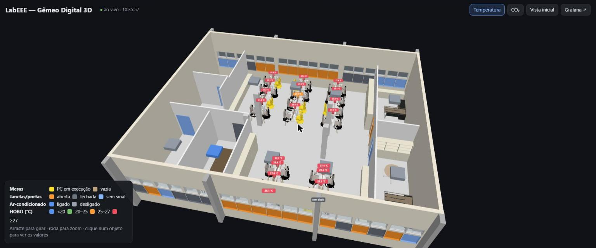
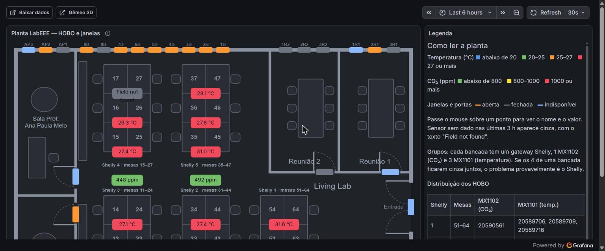
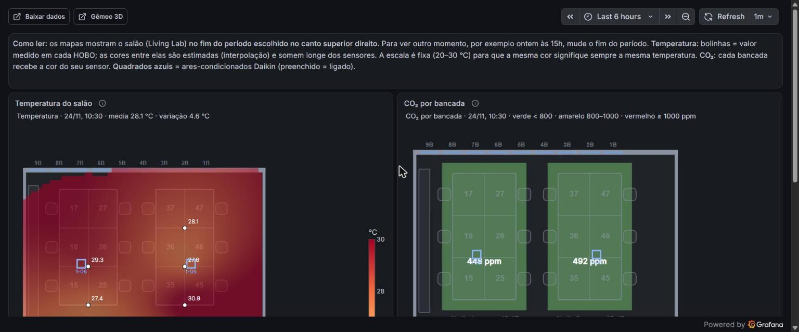
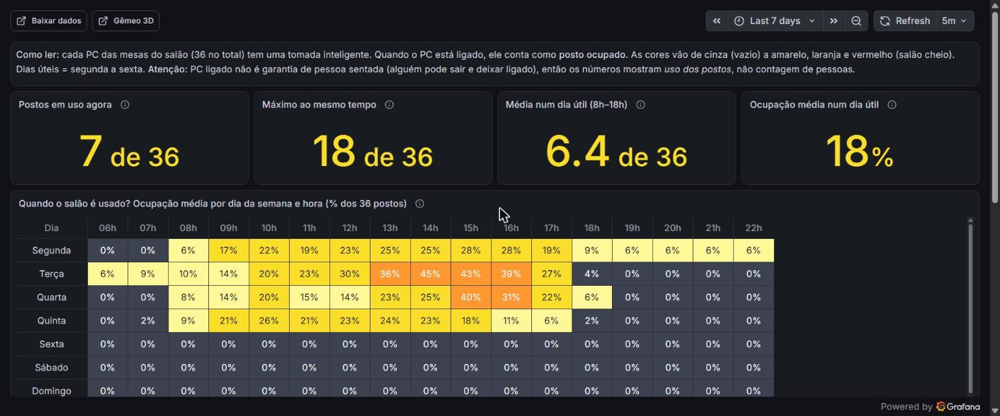
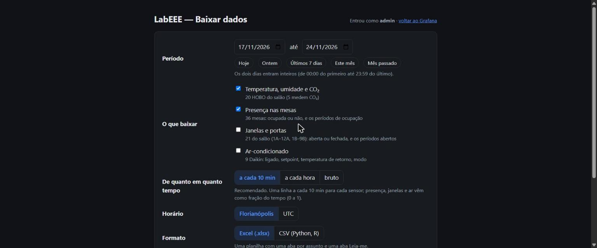
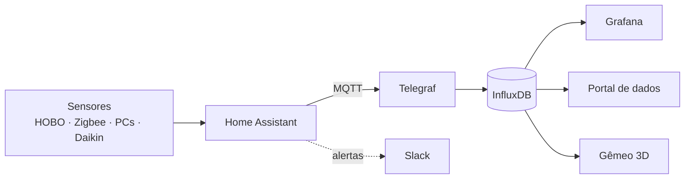

# Gêmeo Digital do LabEEE

**Plataforma de monitoramento em tempo real do Laboratório de Eficiência Energética em Edificações (LabEEE/UFSC):** coleta de sensores ambientais, de presença, de janelas e de ar-condicionado, com painéis, exportação de dados para pesquisa, alertas automáticos e um modelo 3D do laboratório ligado aos sensores ao vivo.



<p>


</p>

> **In English:** a real-time digital twin of a university building-energy lab. Sensor data (temperature, humidity, CO₂, desk occupancy, windows/doors, Daikin HVAC) flows from Home Assistant over MQTT into Telegraf → InfluxDB, and is served through Grafana dashboards, a research data-export portal (Flask, Frictionless data packages) and a browser-based 3D twin built from the lab's IFC/BIM model (three.js + web-ifc, pre-processed at build time to load in ~0.1 s). A self-contained demo with simulated data runs with one `docker compose` command.

## O problema

O LabEEE estuda eficiência energética em edificações, mas os dados do próprio laboratório ficavam espalhados:
- registradores HOBO lidos à mão;
- sensores no Home Assistant sem histórico organizado;
- ares-condicionados sem registro de uso.

Não havia como responder perguntas simples, como "o ar fica ligado com a janela aberta?" ou "como a temperatura varia pelo salão?", nem como entregar dados limpos para os pesquisadores.

## A solução

| | |
|---|---|
| **Coleta contínua** | 20 HOBO (temperatura, umidade e, em 5, CO₂), 36 mesas (presença pelo PC ligado), sensores Zigbee de janelas e portas e 9 Daikin via Modbus. Publicação no MQTT a cada 10 min e a cada mudança. |
| **Banco e painéis** | InfluxDB 2 + 9 painéis no Grafana: plantas 2D ao vivo, mapa de calor interpolado da temperatura, ocupação por horário, desperdício de energia, saúde da coleta. |
| **Portal de dados** | Exportação padronizada para pesquisa (CSV/Excel, 10 min · 1 h · bruto, fuso escolhido, tabelas de períodos, dicionário e `datapackage.json`), com o mesmo login do Grafana e pacotes mensais automáticos. |
| **Gêmeo 3D** | O modelo BIM (IFC) do laboratório no navegador. Mesas, janelas, portas, sensores e ares mudam de cor com os dados ao vivo; clicando num objeto aparecem os valores e o link para o histórico. |
| **Alertas** | Slack com o lugar do problema: ar ligado com janela aberta, sem ninguém embaixo ou fora do horário; CO₂ > 1000 ppm; sensor, gateway ou servidor fora do ar, com aviso quando volta. |
| **Operação** | Tudo em Docker, configuração versionada, backup diário com aviso de falha, runbook. |

## Resultados

- **~85 séries** coletadas continuamente, cada sensor republicado a cada 10 min, o que torna "30 min sem dado" um alarme confiável.
- **Gêmeo 3D de 60 s para ~0,1 s** de carregamento: 8,9 milhões → ~430 mil triângulos e 3.442 → ~250 chamadas de desenho (veja [decisões técnicas](docs/decisoes.md#4-gêmeo-3d-o-modelo-é-cozido-no-build)).
- Dados prontos para análise em Python, R ou Excel, sem limpeza manual.

| Planta 2D (ambiente) | Mapa de calor da temperatura |
|---|---|
|  |  |
| **Ocupação do salão** | **Portal de dados** |
|  |  |

## Arquitetura



Detalhes em [docs/arquitetura.md](docs/arquitetura.md); o porquê das escolhas em [docs/decisoes.md](docs/decisoes.md).

## Rodar a demo (dados simulados)

Precisa só do Docker:

```bash
git clone https://github.com/Pedrossteiner/Digital-Twin-LabEEE-UFSC.git
cd Digital-Twin-LabEEE-UFSC/demo
docker compose up -d --build
```

- **Grafana:** http://localhost:3000 (usuário `admin`, senha `admin`). Os painéis estão na pasta *LabEEE*.
- **Portal de dados:** http://localhost:8090. Entre primeiro no Grafana: o portal usa o mesmo login.
- **Gêmeo 3D:** http://localhost:8090/gemeo3d. Usa o modelo BIM real do LabEEE (`portal-dados/modelo/Labeee_gemeo.ifc`) com os dados simulados. Para usar outro modelo, veja a [convenção de nomes](portal-dados/modelo/LEIAME.md).

O simulador preenche 7 dias de histórico e continua gravando dados novos a cada minuto.

## Estrutura

```
├── docker-compose.yml       produção: InfluxDB, Grafana, Telegraf, portal
├── telegraf/                assinaturas MQTT → InfluxDB
├── grafana/dashboards/      os 9 painéis (JSON)
├── portal-dados/            Flask: exportação, pacotes mensais, Gêmeo 3D (+ modelo IFC do lab)
│   ├── app/exportar.py      consultas Flux, agregação, períodos, CSV/Excel/datapackage
│   ├── app/static/cozinhar.mjs   IFC → malhas leves (Node no build / navegador)
│   └── testes/              fonte de dados simulada e testes
├── home-assistant/          automações de publicação e alertas
├── scripts/backup.sh        backup diário
├── demo/                    docker compose com simulador
└── docs/                    arquitetura e decisões técnicas
```

## Meu papel

Sou **Pedro Santana Steiner**, estudante de Engenharia de Controle e Automação na UFSC e integrante do **LabEEE** (Laboratório de Eficiência Energética em Edificações), onde desenvolvi este projeto em 2026, com Leonardo Savi. Fiz:
- a recuperação e reestruturação do pipeline de coleta (Home Assistant → MQTT → Telegraf → InfluxDB);
- as automações de publicação e de alertas;
- os painéis do Grafana;
- o portal de dados e o padrão de exportação;
- o Gêmeo 3D (preparação do modelo BIM, visualizador e otimização);
- a operação do servidor (Docker, backup, documentação).

O modelo BIM do laboratório foi feito pelo LabEEE; aqui ele recebeu os nomes que ligam cada objeto ao seu sensor.

Desenvolvido com apoio de IA (Claude, da Anthropic).

## Licença

[MIT](LICENSE). O modelo BIM e a planta do laboratório são do LabEEE/UFSC e estão aqui como exemplo; os dados reais dos sensores não fazem parte deste repositório.
