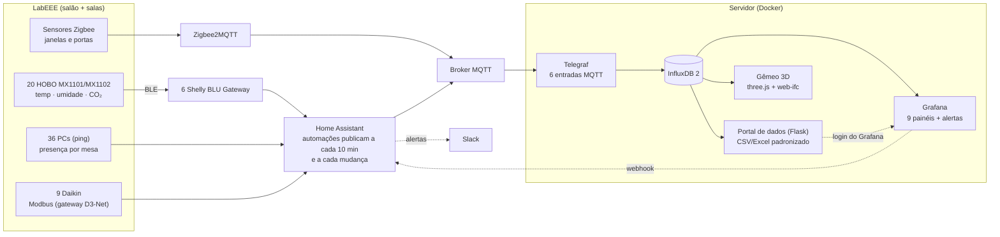

# Arquitetura

## Caminho do dado

| Tópico MQTT | Quem publica | Medição no InfluxDB | Tag | Campos |
|---|---|---|---|---|
| `lab/hobo/<serie>` | automação HA | `ambiente` | serie | temp_c, ur_pct, co2_ppm |
| `lab/presenca/<mesa>` | automação HA | `presenca` | pc | presente (0/1) |
| `lab/janela/<NOME>` | automação HA | `janela` | nome | aberta, disponivel, bateria |
| `lab/daikin/<unidade>` | automação HA | `daikin` | unidade | ligado, setpoint, temp_retorno, modo, ventilador, filtro_sujo |
| `zigbee2mqtt/<nome>` | Zigbee2MQTT | `zigbee` | topic | contact, battery, linkquality |
| `zigbee2mqtt/<nome>/availability` | Zigbee2MQTT | `zigbee_disponibilidade` | topic | online/offline |

O Home Assistant republica o estado a cada 10 min, além de publicar a cada mudança. Assim, "sem dado há mais de 30 min" sempre significa sensor ou coleta com problema, e não só "nada mudou".

## Serviços

| Serviço | O que faz |
|---|---|
| InfluxDB 2.7 | Banco de séries temporais (org `LabEEE`, bucket `LabEEE`) |
| Telegraf | Assina os tópicos MQTT e grava no InfluxDB (`telegraf/telegraf.conf`) |
| Grafana 13 | Painéis (`grafana/dashboards/`), alerta "fonte de dados parada" |
| Portal de dados | Exportação padronizada e Gêmeo 3D (`portal-dados/`) |
| Backup | `scripts/backup.sh`, diário: painéis para o git, volumes e `.env` para disco, aviso se falhar |
